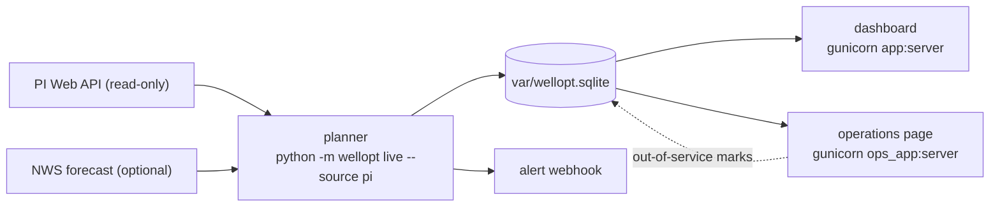

# Running it live

## What "live" means here

The live version is **advisory**. Every hour a planner reads the historian, checks the data, forecasts
demand, plans the next 48 hours and stores the plan. The dashboard and the operations page show it, and
alerts go to a webhook. Nothing writes to SCADA or to the historian (the PI adapter only makes GET
requests). Operators decide what to run.



## One planning cycle

1. **Fetch.** Hourly time-weighted averages for every mapped tag since the last cached hour; the last
   3 hours are read again to pick up late values. The first start backfills `lookback_days` (730) in
   30-day chunks, so expect a few thousand requests the first time.
2. **Check.** The same quality control as the backtest runs on the cached rows.
3. **Staleness.** A section with no pump telemetry for `stale_after_minutes` (120) is not re-planned.
   An alert says so, and the dashboard keeps the last plan with a "Plan is … old" badge.
4. **Starting storage.** Tank telemetry when it is mapped and recent (`TNK_<Section>_MG`, within 2 hours);
   otherwise the level the previous plan expected (assuming operators followed it); otherwise the
   configured starting level. The plan's notes say which one was used.
5. **Forecast.** The saved model in `models/`, retrained when it is older than `retrain_every_days` (28).
   If it fails or predicts something implausible, the seasonal-naive forecast is used and a warning
   raised.
6. **Plan.** The MILP; the rule plan if the MILP fails (with a warning).
7. **Store and alert.** Plans and alerts go to the SQLite store, new warnings and alerts to the webhook,
   and old plans are pruned.

The CSV source (`--source csv`) runs the same cycle against the 2016–2019 export, one simulated hour
after another. Use it to try the setup before connecting a historian.

## Setting it up

1. **Site config.** Replace every value marked ASSUMPTION in `config/site.toml` (tanks, tariff,
   operating limits, time zone; see [METHODOLOGY.md](METHODOLOGY.md#8-what-to-confirm-before-trusting-the-numbers)).
2. **Tag map.** Copy `config/pi_tags.example.csv` to `config/pi_tags.csv` (it is git-ignored) and give
   each export column its PI point path: `PMP_<n>_FLOW`, `PMP_<n>_PRESS` and `PMP_<n>_PowerUsage(kW-H)`
   for every pump, and optionally `TNK_North_MG` and `TNK_South_MG`. Values are stamped with the start
   of their hour; if the export was hour-ending, change `time_type` in `wellopt/live/sources.py`.
3. **Historian connection.** In `[live]`, set `pi_base_url` (for example
   `https://pi.your-utility.example/piwebapi`). Keep `pi_verify_tls = true`; if the utility uses a
   private certificate authority, point `pi_ca_bundle` at its bundle. Credentials come only from the
   environment, `WELLOPT_PI_USER` and `WELLOPT_PI_PASSWORD` (HTTP basic). Use a read-only service
   account. Kerberos sites can pass a `requests` auth object to `PIWebAPISource`.
4. **Try one cycle**, then open the dashboard:

   ```bash
   python -m wellopt live --source pi --once
   ```

5. **Run it continuously** with Docker or a service manager (below).

## Docker

Put the settings in a `.env` file next to `docker-compose.yml` (git-ignored):

```
WELLOPT_SOURCE=pi
WELLOPT_PI_USER=svc-wellopt
WELLOPT_PI_PASSWORD=change-me
```

Then start the dashboard (port 8000), the operations page (port 8001) and the planner:

```bash
docker compose --profile live up -d --build
```

The containers share the `var`, `models` and `reports` volumes. `config/` is mounted read-only from
the checkout. They read `site.toml` at startup, so restart them after editing it (the operations page
reads `pump_curves.csv` again by itself whenever it changes):

```bash
docker compose --profile live restart
```

Give Docker at least 4 GB of memory: training the demand model on two years of hourly data is the
largest step.

## Without Docker

Linux, with systemd (one unit for the planner; the dashboard is the same with
`ExecStart=/opt/wellopt/.venv/bin/gunicorn app:server --bind 0.0.0.0:8000 --workers 1 --threads 4`, and
the operations page with `ExecStart=/opt/wellopt/.venv/bin/gunicorn ops_app:server --bind 0.0.0.0:8001 --workers 1 --threads 4`):

```ini
[Unit]
Description=wellopt advisory planner
After=network-online.target

[Service]
WorkingDirectory=/opt/wellopt
EnvironmentFile=/etc/wellopt.env
ExecStart=/opt/wellopt/.venv/bin/python -m wellopt live --source pi
Restart=on-failure
User=wellopt

[Install]
WantedBy=multi-user.target
```

Windows: run `python -m wellopt live --source pi` as a service (for example with NSSM or Task Scheduler
at startup). gunicorn doesn't run on Windows; serve the dashboard with
`waitress-serve --listen=0.0.0.0:8000 app:server` (`pip install waitress`), and the operations page
with `waitress-serve --listen=0.0.0.0:8001 ops_app:server`. `python app.py` and `python ops_app.py` are
fine for a single user.

## Dashboard settings

| Variable | Default | Meaning |
|---|---|---|
| `WELLOPT_CONFIG` | `config/site.toml` | Site config to load. |
| `HOST`, `PORT` | `127.0.0.1`, `8050` | Address for `python app.py` (gunicorn takes `--bind`). |
| `WELLOPT_BOOTSTRAP_CSS` | Bootstrap from jsDelivr | Stylesheet URL. On a network without internet access, set it to `local` and put `bootstrap.min.css` in `assets/`, or `none`. |

The operations page takes `OPS_PORT` (8051) instead of `PORT`. It needs no stylesheet setting: it serves
its own files and loads nothing from the internet; see [OPS_PAGE.md](OPS_PAGE.md#running-it).

**The dashboard and the operations page have no login.** Serve them on the plant network only, or
behind the utility's reverse proxy with authentication and TLS. A what-if re-plan runs the optimizer on
the server (up to about 20 seconds of CPU per click) and is never saved. On the operations page, anyone
who can open it can mark a pump out of service, which is saved and changes the plans.

## Alerts

| Key | Level | When |
|---|---|---|
| `stale_data` | alert | No pump telemetry for `stale_after_minutes`; the section isn't re-planned. |
| `storage_floor` | alert | The plan's high-demand path drops below the floor. |
| `storage_min` | warning | The plan's high-demand path drops below the reserve. |
| `pump_data:<pump>` | warning | 3 or more missing or rejected readings for that pump in the last 6 hours. |
| `milp_fallback` | warning | The optimizer failed and the rule plan was used. |
| `forecast_fallback` | warning | The demand model failed and the seasonal-naive forecast was used. |
| `runner_error` | alert | A planning cycle failed; the next one still runs. |
| `out_of_service:<pump>` | info | The pump was marked out of service, or returned to service, on the operations page. |

An alert isn't raised again for the same section and key while an unacknowledged copy is less than
6 hours old; `out_of_service` alerts are recorded every time. Operators acknowledge alerts on the
dashboard.

Set `[live] alert_webhook` to send new warnings and alerts as JSON:
`{"text": ..., "site": ..., "alerts": [{"section", "level", "key", "message", "plan_time"}]}`. The `text`
field makes Slack and Microsoft Teams incoming webhooks display them. A failed webhook is logged and
never stops planning.

## Weather (optional)

`weather_enabled = true` with `weather_lat` and `weather_lon` stores the National Weather Service hourly
forecast (US only) so operators see the next two days' temperatures next to the plan. The demand models
don't use it yet. NWS asks callers to identify themselves: set `weather_user_agent` to an app name and a
contact address, for example `"wellopt (ops@your-utility.example)"`.

## The plan store

`var/wellopt.sqlite` holds runs, plans, alerts, cached historian rows, weather and out-of-service marks,
in WAL mode so the pages can read while the planner writes. The planner writes almost everything. The
dashboard records alert acknowledgements. The operations page records out-of-service marks, and saves
the plan it redoes after each one ([OPS_PAGE.md](OPS_PAGE.md#out-of-service)).

* Each hourly cycle adds about 50 KB (two sections). After every cycle, plans older than
  `plan_retention_days` (365; 0 keeps everything) are deleted, keeping the newest plan per section, and
  cached historian rows older than `lookback_days` + 7 days are dropped.
* Back it up while the planner runs with `sqlite3 var/wellopt.sqlite ".backup backup.sqlite"`.
* `models/` holds the demand models as joblib pickles. Load only files this project wrote: unpickling a
  file from an untrusted source can run arbitrary code.

## When something breaks

| Problem | What the planner does | What operators see |
|---|---|---|
| Historian unreachable | Logs it and plans from cached data; once the data is older than `stale_after_minutes`, it stops re-planning that section. | `stale_data` alert; the last plan with its age. |
| Bad readings from a pump | QC rejects them; the section's production for those hours is unknown. | `pump_data:<pump>` warning. |
| Demand model fails | Uses the seasonal-naive forecast. | `forecast_fallback` warning; the plan names its forecaster. |
| MILP fails or runs out of time | Uses the rule plan, or the best schedule found. | `milp_fallback` warning, or a "Solver time limit" badge. |
| A cycle crashes | Records the error and runs the next cycle. | `runner_error` alert. |
| The planner process dies | Docker or systemd restarts it. | Plans stop updating; "Plan is … old" badge, and the operations page's ▲ plan-age line. |

## Before anyone relies on it

Run it in shadow mode for a few weeks: let operators work as usual, compare their choices with the
recommendations every day, and ask why when they differ. Their answers usually turn into constraints
(`must_run`, group limits, operating rules) or point at data problems. Reconcile the kW tag with utility
bills before quoting savings in dollars.
